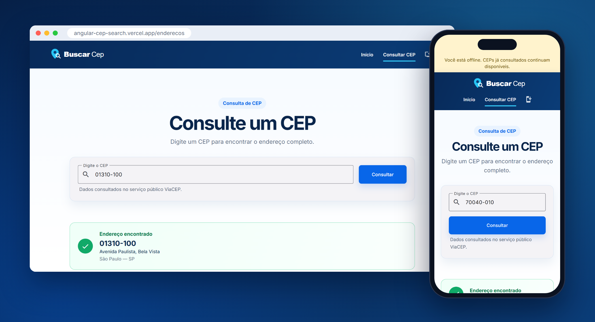
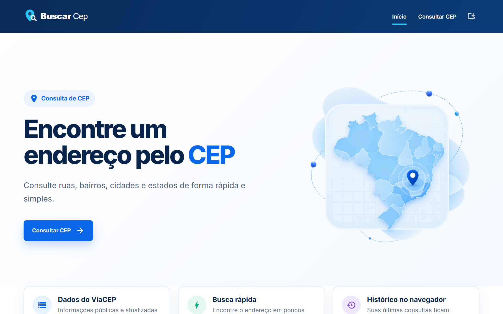
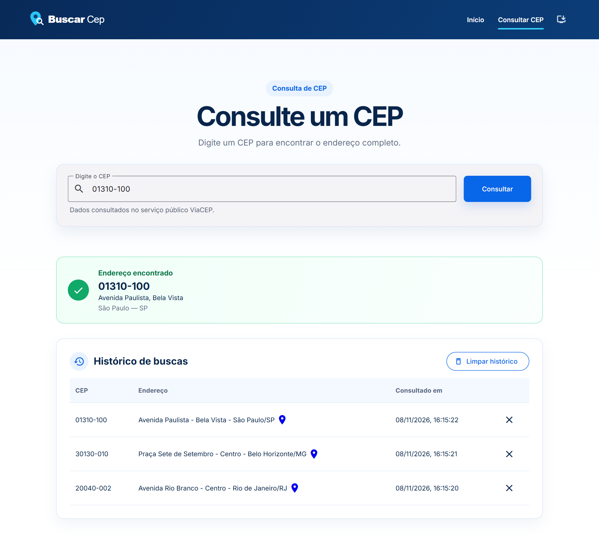
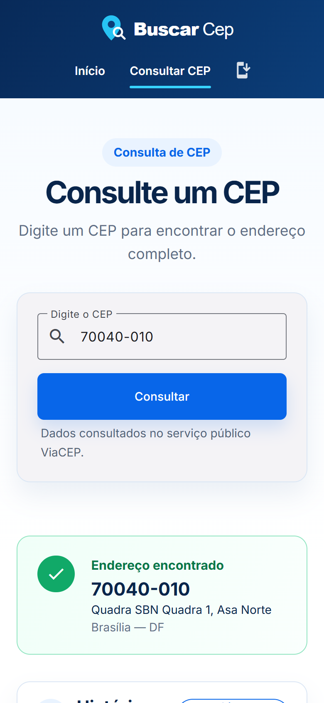
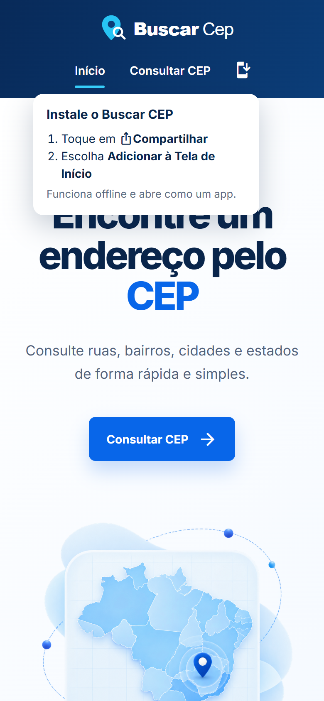
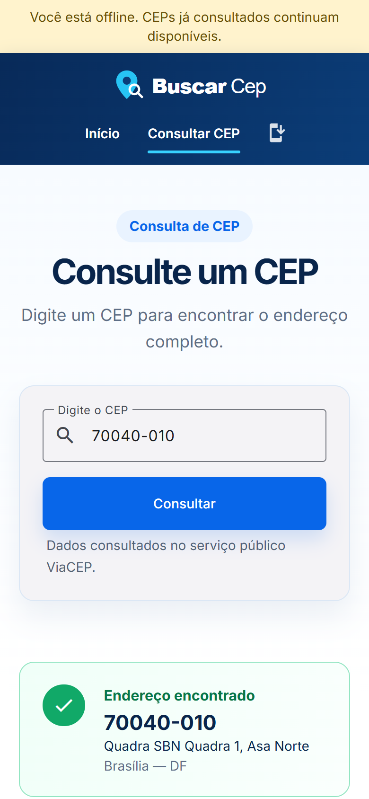
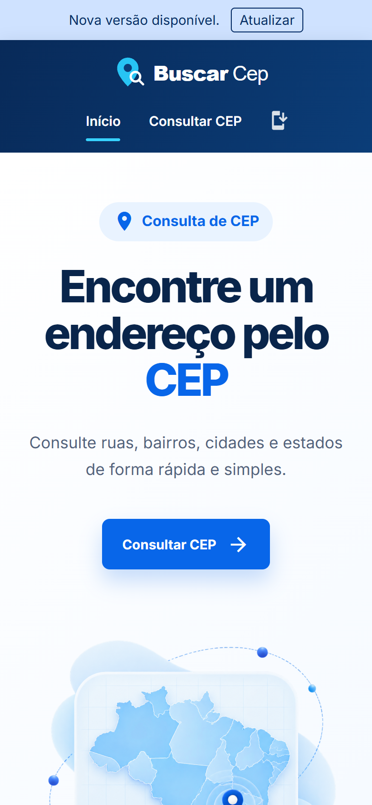

<h1 align="center">Angular CEP Search</h1>

<p align="center">
  Busca de CEPs brasileiros em Angular, <b>instalável como app e com funcionamento offline (PWA)</b>.
</p>

<p align="center">
  <a href="https://angular-cep-search.vercel.app/"></a>
  
  
  
  <a href="LICENSE"></a>
</p>

<p align="center">
  <a href="https://angular-cep-search.vercel.app/"><b>Acessar a aplicação →</b></a>
</p>

<p align="center">
  
</p>

## Sobre

SPA desenvolvida em Angular para busca de CEPs brasileiros e manutenção de um histórico de consultas, utilizando a API pública ViaCEP.

A aplicação também é um **PWA (Progressive Web App)**: pode ser instalada no celular ou no computador, funciona offline e avisa quando há uma nova versão disponível.

Repositório: [igortomp100/angular-cep-search](https://github.com/igortomp100/angular-cep-search)

## Demonstração

<p align="center">
  
</p>

<p align="center">
  Busca de um CEP, perda de conexão e uma nova busca respondida pelo cache offline.
</p>

## Telas

### Desktop





### Mobile

<p align="center">
  
  &nbsp;&nbsp;
  
</p>

## Tecnologias

- Angular 22
- TypeScript
- Sass
- Angular Material
- Reactive Forms
- RxJS
- localStorage
- ViaCEP
- Angular Service Worker (PWA)
- Fontsource (fontes hospedadas localmente)

## Instalação

Clone o repositório e acesse a pasta do projeto:

```bash
git clone https://github.com/igortomp100/angular-cep-search.git
cd angular-cep-search
```

Instale as dependências:

```bash
npm install
```

## Execução local

Para iniciar o projeto em ambiente de desenvolvimento:

```bash
npm run start
```

A aplicação estará disponível em `http://localhost:4200`.

## Build de produção

Para gerar os arquivos de produção:

```bash
npm run build
```

Os arquivos são gerados em `dist/consulta-cep/browser`.

## Deploy

O conteúdo da pasta `dist/consulta-cep/browser` pode ser publicado em serviços de hospedagem estática, como GitHub Pages, Netlify, Vercel, Firebase Hosting ou em um servidor web próprio.

Por ser uma SPA Angular, o servidor deve redirecionar rotas desconhecidas para `index.html`, preservando o funcionamento da navegação por URL.

O service worker exige HTTPS em produção (em `localhost` funciona sem HTTPS).

## Funcionalidades

- Navegação entre Home, Endereços e Buscar Endereços.
- Carregamento lazy dos módulos Home e Endereços.
- Consulta de CEP pela API ViaCEP.
- Máscara no formato `00000-000`.
- Validação de CEP vazio, incompleto, inválido, não encontrado ou já pesquisado.
- Feedback visual de erro e estado de carregamento durante a consulta.
- Listagem de buscas realizadas, com as consultas mais recentes no topo.
- Persistência do histórico no `localStorage`.
- Exclusão de itens do histórico.
- Layout responsivo para desktop e dispositivos móveis.
- Logo vetorial próprio no header.
- Instalação como app (PWA) no celular e no computador, com ícone "Instalar app" no menu.
- Funcionamento offline, inclusive para CEPs já consultados.
- Avisos de "você está offline" e de "nova versão disponível".

## PWA

A aplicação pode ser instalada e usada como um app, com ícone próprio, janela sem barra do navegador e funcionamento offline.

<table>
  <tr>
    <td align="center"></td>
    <td align="center"></td>
    <td align="center"></td>
  </tr>
  <tr>
    <td align="center"><b>Instalar app</b><br />Ícone no menu com o passo a passo (iPhone)</td>
    <td align="center"><b>Offline</b><br />O app segue funcionando sem internet</td>
    <td align="center"><b>Atualização</b><br />Aviso quando há uma nova versão</td>
  </tr>
</table>

### Ícones do app

<p>
  
  &nbsp;
  
  &nbsp;
  
</p>

Ícone padrão, versão *maskable* (recortada pelo Android no formato de cada aparelho) e versão para iOS.

### Como instalar

- **Android e computador (Chrome/Edge):** pelo aviso automático do navegador, pelo ícone de instalar na barra de endereço ou pelo ícone **Instalar app** no menu da aplicação.
- **iPhone (Safari):** toque em **Compartilhar → Adicionar à Tela de Início**. O ícone do menu mostra esse passo a passo.
- **Safari no Mac:** **Arquivo → Adicionar ao Dock**.

### O que funciona offline

| Recurso | Estratégia |
|---|---|
| Aplicação (HTML, JS, CSS, logo e fontes) | Baixada na instalação do service worker, disponível offline já na primeira visita |
| Imagens e demais arquivos estáticos | Guardados em cache conforme são acessados |
| Consultas ao ViaCEP | *Freshness*: online sempre consulta a API; offline (ou após 5s sem resposta) usa a última resposta guardada |
| Histórico de buscas | Mantido no `localStorage` |

### Atualizações

A cada deploy, o service worker baixa a nova versão em segundo plano e a aplicação exibe o aviso **"Nova versão disponível"**, com botão para atualizar.

### Arquivos envolvidos

- `ngsw-config.json`: regras de cache do service worker.
- `public/manifest.webmanifest`: nome, cores e ícones do app.
- `public/icons/`: ícones do app (padrão, *maskable* para Android e `apple-touch-icon` para iOS).
- `src/app/core/services/pwa.ts`: estado online/offline, aviso de atualização e instalação.

### Testando localmente

O service worker fica desativado no `ng serve`. Para testar o PWA, gere o build de produção e sirva a pasta gerada:

```bash
npm run build
python -m http.server 8080 --directory dist/consulta-cep/browser
```

Acesse `http://localhost:8080` e use o DevTools (**Application → Service workers / Manifest / Cache storage**). Para simular a falta de conexão, use **Network → Offline**.

## Estrutura principal

```text
docs                 # imagens e GIF usados neste README
src/app
├── core
│   ├── models
│   └── services
├── pages
│   ├── home
│   └── enderecos
└── shared
    ├── header
    └── page-intro
```

## Decisões técnicas

- Home e Endereços são módulos carregados sob demanda com lazy loading.
- A busca utiliza Reactive Forms para controlar e validar o campo de CEP.
- O serviço `ViaCep` centraliza a comunicação com a API.
- A comunicação entre componentes usa `@Input()` e `@Output()` com `EventEmitter`.
- O componente pai mantém o estado das buscas e delega a persistência ao serviço de histórico.
- Variáveis Sass centralizam cores e estilos reutilizáveis.
- Angular Material é utilizado nos componentes de formulário e interação.
- As fontes (Inter e Material Icons) são hospedadas no próprio projeto via Fontsource, para que textos e ícones funcionem offline sem depender do Google Fonts.
- O serviço `Pwa` concentra o estado do service worker com signals (online/offline, atualização disponível e modo de instalação).
- O aviso automático de instalação do navegador é mantido; o ícone do menu é uma opção adicional.

## Licença

Distribuído sob a licença MIT. Veja [LICENSE](LICENSE).
